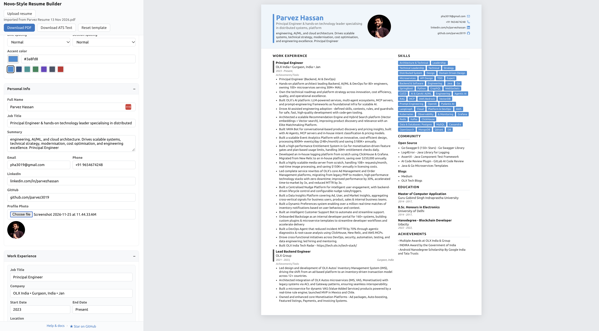

# Novo-Style Resume Builder

**A free, private, open-source resume builder that runs entirely in your browser.** Edit with a live A4 preview, export a polished PDF and an ATS-friendly plain-text version. No signup, no server, and your resume never leaves your device.

[](https://parvez3019.github.io/novo-style-resume-builder/)
[](https://parvez3019.github.io/novo-style-resume-builder/docs/)
[](LICENSE)
[](https://github.com/parvez3019/novo-style-resume-builder/actions/workflows/deploy.yml)



> If this saves you time, please **⭐ star the repo**. It helps other job seekers find it.

## Why this one?

- 🔒 **Private by design:** no account, no backend. Data lives in your browser's `localStorage`.
- 👀 **Live A4 preview:** what you see is what you print.
- 📄 **PDF export:** clean, selectable-text PDF via your browser's print dialog.
- 🤖 **ATS text export:** a plain-text version that applicant tracking systems parse reliably.
- 📥 **Import:** upload an existing `.pdf`, `.txt` or `.json` resume to auto-fill the fields.
- 💾 **JSON backup:** download a full-fidelity `.json` (theme and photo included) and restore it any time.
- 🎨 **Theming:** 7 fonts, 3 template sizes, line and section spacing, any accent colour.
- 🧩 **Sections:** personal info and photo, work experience, skills, community (open source, blogs), education, achievements.

## Quick start

**Use it online:** <https://parvez3019.github.io/novo-style-resume-builder/>

**Run it locally** (Node.js 20+):

```bash
git clone https://github.com/parvez3019/novo-style-resume-builder.git
cd novo-style-resume-builder
npm install
npm run dev
```

Open the URL shown in the terminal (usually `http://localhost:5173/novo-style-resume-builder/`).

```bash
npm run build     # production build in dist/
npm run preview   # serve the build locally
```

## Exporting a PDF

1. Click **Download PDF**.
2. In the print dialog, choose **Save as PDF**, turn **off** "Headers and footers", and set margins to **None**.

More tips are in the [PDF export guide](https://parvez3019.github.io/novo-style-resume-builder/docs/guide/export-pdf/).

## Documentation

Full docs, including a user guide, ATS tips, self-hosting, and architecture: **<https://parvez3019.github.io/novo-style-resume-builder/docs/>**

## Contributing

Contributions are very welcome. See [CONTRIBUTING.md](CONTRIBUTING.md) and look for issues labelled [`good first issue`](https://github.com/parvez3019/novo-style-resume-builder/labels/good%20first%20issue).

## Tech stack

[Vite](https://vitejs.dev/) · [React](https://react.dev/) · TypeScript · plain CSS · [pdf.js](https://mozilla.github.io/pdf.js/) · [lucide-react](https://lucide.dev/) · docs with [Material for MkDocs](https://squidfunk.github.io/mkdocs-material/)

## License & disclaimer

[MIT](LICENSE).

This is an independent, educational project. It is **not** the official Novo Resume / NovoResume product and is not affiliated with, endorsed by, or sponsored by it. "Novo-style" describes a common two-column resume layout. Read the full [disclaimer & fair-use note](DISCLAIMER.md).
