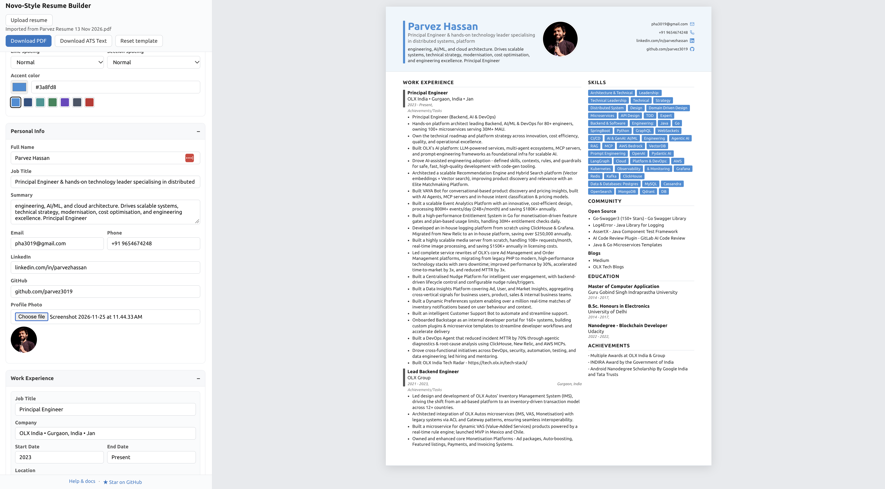

# Novo-Style Resume Builder

**A free, private, open-source resume builder that runs entirely in your browser.**
Edit with a live A4 preview, export a polished PDF and an ATS-friendly plain-text version. No signup, no server.

[Open the app :material-open-in-new:](https://parvez3019.github.io/novo-style-resume-builder/){ .md-button .md-button--primary }
[Star on GitHub :fontawesome-brands-github:](https://github.com/parvez3019/novo-style-resume-builder){ .md-button }

-   :material-shield-lock: **Private by design**

    No account, no backend. Your resume is stored only in your browser. [Learn more](privacy.md)

-   :material-eye: **Live A4 preview**

    Every keystroke updates the page. What you see is what you print.

-   :material-file-pdf-box: **PDF export**

    Clean PDF with selectable text from your browser's print dialog. [How-to](guide/export-pdf.md)

-   :material-robot: **ATS text export**

    A plain-text version that applicant tracking systems parse reliably. [How-to](guide/export-ats.md)

-   :material-upload: **Import an existing resume**

    Upload a `.pdf`, `.txt` or `.json` to auto-fill the fields. [How-to](guide/import.md)

-   :material-palette: **Theme it**

    7 fonts, 3 sizes, spacing controls and any accent colour. [How-to](guide/themes.md)

## Who is it for?

- **Job seekers** who want a clean, modern two-column resume without paying for a subscription or handing over personal data.
- **Developers** who want a hackable, self-hostable resume tool built with React + TypeScript. See [Architecture](architecture.md).

!!! note "Independent project"
    This is an independent, educational, open-source project. It is not the official Novo Resume / NovoResume product and is not affiliated with it.
